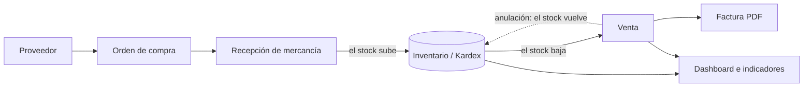

# Distribuidora Tecnológica — ERP académico


Proyecto base de la asignatura **Software de Gestión Empresarial** (COTECNOVA, 2026-2). Es un **ERP (Enterprise Resource Planning)** construido desde cero con Laravel para una empresa ficticia, la *Distribuidora Tecnológica S.A.S.*, que compra y vende productos de tecnología.

> [!NOTE]
> Este repositorio es el **ejemplo de referencia** del curso: muestra cómo queda el proyecto después de aplicar las guías de clase. Cada estudiante desarrolla **su propio ERP** para su empresa. Úselo para comparar, consultar y entender, no para copiar y pegar.

---

## Tabla de contenido

1. [¿Qué es y para qué sirve?](#qué-es-y-para-qué-sirve)
2. [Funcionalidades](#funcionalidades)
3. [Tecnologías](#tecnologías)
4. [Requisitos previos](#requisitos-previos)
5. [Instalación paso a paso](#instalación-paso-a-paso)
6. [Usuarios de prueba](#usuarios-de-prueba)
7. [Uso diario](#uso-diario)
8. [Comandos útiles](#comandos-útiles)
9. [Estructura del proyecto](#estructura-del-proyecto)
10. [Conceptos clave de la arquitectura](#conceptos-clave-de-la-arquitectura)
11. [Pruebas automatizadas](#pruebas-automatizadas)
12. [Solución de problemas](#solución-de-problemas)
13. [Cómo usar este proyecto como referencia](#cómo-usar-este-proyecto-como-referencia)

---

## ¿Qué es y para qué sirve?

Un ERP integra en un solo sistema los procesos de una empresa: lo que se compra, lo que hay en bodega, lo que se vende y quién hace cada cosa. En lugar de usar varias hojas de cálculo que no se hablan entre sí, **cada operación actualiza automáticamente a las demás**:



En el curso, el proyecto sirve para aprender, con un caso realista:

- A **analizar procesos de negocio** (compras, inventario, ventas) y convertirlos en reglas del sistema.
- A **modelar una base de datos relacional** (cabecera y detalle, llaves foráneas, borrado lógico).
- A **controlar el acceso** con roles y permisos por puesto de trabajo.
- A garantizar la **integridad de los datos** con transacciones y bloqueos.
- A dejar **trazabilidad**: auditoría de cambios y kardex de inventario.
- A presentar la información para **tomar decisiones** (indicadores y gráficos).

## Funcionalidades

| Módulo | Qué hace | Clase |
|---|---|---|
| Productos y categorías | CRUD con búsqueda, filtros, papelera (Soft Delete) y restauración | 4 a 7 |
| Roles y permisos | Spatie Permission: roles por puesto (admin, vendedor, almacenista), permisos por módulo, `@can` en vistas y middleware en controladores | 7 |
| Clientes y ventas | Venta con cabecera y detalle, IVA del 19 %, factura secuencial `FV-00001`, descuento de stock y anulación con devolución | 8 |
| Dashboard | Indicadores (KPI) filtrados por permisos y top 5 de productos | 9 |
| Proveedores y compras | Orden de compra `OC-00001`, recepción total o parcial que aumenta el stock, reglas (no recibir más de lo pedido) | 10 |
| Documentos PDF | Factura de venta, orden de compra y kardex con DomPDF | 10 y 12 |
| Configuración de seguridad | Usuarios con varios roles, **rol activo** al iniciar sesión, permisos directos, matriz de permisos y reglas de protección | Guía de roles |
| Auditoría | Bitácora de quién creó, modificó o eliminó cada registro, con los valores antes → después (spatie/laravel-activitylog) | 12 |
| Kardex | Cada entrada y salida de inventario con su documento, usuario y saldo; ajustes de inventario con motivo obligatorio | 12 |
| Identidad corporativa | Nombre, logo, NIT, razón social y color de marca configurables; menú lateral y Dashboard con gráficos (Chart.js) | Guía visual |

## Tecnologías

| Herramienta | Versión | Para qué se usa |
|---|---|---|
| [Laravel](https://laravel.com/docs) | 13 | Framework de PHP (MVC, rutas, Eloquent, migraciones) |
| PHP | 8.5 (en el contenedor) | Lenguaje del servidor |
| MySQL | 8.4 | Base de datos |
| [Laravel Sail](https://laravel.com/docs/sail) | 1.x | Entorno de desarrollo con Docker (no hay que instalar PHP ni MySQL en el equipo) |
| [Laravel Breeze](https://laravel.com/docs/starter-kits) | 2.x | Inicio de sesión, registro y perfil (Blade + Tailwind) |
| [spatie/laravel-permission](https://spatie.be/docs/laravel-permission) | 8.x | Roles y permisos |
| [spatie/laravel-activitylog](https://spatie.be/docs/laravel-activitylog) | 5.x | Auditoría |
| [barryvdh/laravel-dompdf](https://github.com/barryvdh/laravel-dompdf) | 3.x | Documentos PDF |
| Tailwind CSS + Alpine.js | 3.x | Estilos e interactividad de las vistas |
| [Chart.js](https://www.chartjs.org/) | 4.x | Gráficos del Dashboard |
| Vite | 8.x | Compilación de CSS y JavaScript |

## Requisitos previos

El curso trabaja en **Windows con WSL 2 (Ubuntu)**. En Linux o macOS los pasos son los mismos, sin la parte de WSL.

1. **WSL 2 con Ubuntu.** En PowerShell como administrador:
   ```powershell
   wsl --install -d Ubuntu
   ```
2. **Docker Desktop** con la integración de WSL activada: *Settings → Resources → WSL Integration → Ubuntu*.
3. **Git** dentro de Ubuntu (normalmente ya viene instalado):
   ```bash
   git --version
   ```
4. **Visual Studio Code** con las extensiones *WSL*, *Laravel Blade Snippets*, *PHP Intelephense*, *Tailwind CSS IntelliSense* y *DotENV*.

> [!IMPORTANT]
> Clone y trabaje el proyecto **dentro de Ubuntu** (por ejemplo, en `~/proyectos`), **no** en `/mnt/c/...`. Las carpetas de Windows vistas desde WSL son muy lentas y causan errores de permisos con Docker.

## Instalación paso a paso

Todos los comandos se ejecutan en la **terminal de Ubuntu**. Verifique primero que Docker Desktop esté abierto.

### 1. Clonar el repositorio

```bash
mkdir -p ~/proyectos && cd ~/proyectos
git clone https://github.com/jamescanos/sge.git
cd sge
```

### 2. Instalar las dependencias de PHP

El repositorio no trae la carpeta `vendor/` (ahí está Sail), así que la primera instalación se hace con un contenedor temporal de Composer:

```bash
docker run --rm \
    -u "$(id -u):$(id -g)" \
    -v "$(pwd):/var/www/html" \
    -w /var/www/html \
    laravelsail/php84-composer:latest \
    composer install --ignore-platform-reqs
```

> [!TIP]
> `--ignore-platform-reqs` se usa porque ese contenedor temporal tiene PHP 8.4; el proyecto se ejecuta después en el contenedor de Sail con PHP 8.5.

### 3. Crear el archivo de configuración `.env`

```bash
cp .env.example .env
```

El `.env.example` ya está preparado para Sail (MySQL en el host `mysql`, usuario `sail`, contraseña `password`). Si el puerto 80 está ocupado en su equipo (por ejemplo, por Apache), cambie `APP_PORT=80` por otro, como `APP_PORT=8080`, y use ese puerto en el navegador.

> [!CAUTION]
> El archivo `.env` contiene la clave de la aplicación y las contraseñas: **nunca** se sube a GitHub (ya está en `.gitignore`).

### 4. Levantar los contenedores

```bash
./vendor/bin/sail up -d
```

La primera vez tarda varios minutos porque Docker construye la imagen de PHP. Para verificar que los dos contenedores (`laravel.test` y `mysql`) estén en estado `Up`:

```bash
./vendor/bin/sail ps
```

### 5. Generar la clave y preparar la base de datos

```bash
./vendor/bin/sail artisan key:generate
./vendor/bin/sail artisan migrate --seed
./vendor/bin/sail artisan storage:link
```

- `key:generate` crea la clave `APP_KEY` en el `.env`.
- `migrate --seed` crea las tablas y carga los datos de prueba: roles, permisos, productos, clientes, proveedores, usuarios e identidad corporativa.
- `storage:link` permite mostrar los archivos subidos, como el logo de la empresa.

> [!NOTE]
> Si MySQL todavía está arrancando, `migrate` puede responder *Connection refused*. Espere unos segundos y repita el comando.

### 6. Instalar y compilar el frontend

```bash
./vendor/bin/sail npm install
./vendor/bin/sail npm run build
```

### 7. Abrir el ERP

Ingrese a **http://localhost** (o `http://localhost:PUERTO` si cambió `APP_PORT`) con alguno de los [usuarios de prueba](#usuarios-de-prueba).

### 8. (Opcional) Verificar la instalación y cargar datos de demostración

```bash
# Debe terminar con todas las pruebas en verde
./vendor/bin/sail test

# Compras y ventas de los últimos 6 meses para ver los gráficos del Dashboard con datos
./vendor/bin/sail artisan db:seed --class=DashboardDemoSeeder
```

## Usuarios de prueba

Todos tienen la contraseña **`password`**.

| Usuario | Rol | Qué puede hacer |
|---|---|---|
| `admin@test.com` | admin | Todo: módulos, configuración, auditoría e identidad corporativa |
| `vendedor@test.com` | vendedor | Consultar productos; gestionar clientes y registrar ventas |
| `almacenista@test.com` | almacenista | Productos, categorías, proveedores, compras (con recepción) y kardex |
| `supervisor@test.com` | vendedor + almacenista | Elige con qué **rol activo** trabaja al iniciar sesión; tiene el permiso directo `ver-reportes` |

> [!WARNING]
> Son credenciales de desarrollo. En un despliegue real se eliminan o se cambian sus contraseñas.

## Uso diario

```bash
cd ~/proyectos/sge
./vendor/bin/sail up -d      # encender
./vendor/bin/sail stop       # apagar al terminar (los datos se conservan)
```

Mientras se editan vistas o estilos, `npm run dev` recarga el navegador automáticamente con cada cambio (se detiene con `Ctrl + C`):

```bash
./vendor/bin/sail npm run dev
```

> [!TIP]
> Para no escribir `./vendor/bin/sail` cada vez, agregue un alias a `~/.bashrc`:
> ```bash
> echo "alias sail='sh \$([ -f sail ] && echo sail || echo vendor/bin/sail)'" >> ~/.bashrc && source ~/.bashrc
> ```
> Después basta con `sail up -d`, `sail artisan migrate`, etc.

## Comandos útiles

| Comando | Para qué sirve |
|---|---|
| `./vendor/bin/sail artisan migrate` | Ejecuta las migraciones pendientes |
| `./vendor/bin/sail artisan migrate:fresh --seed` | **Borra todas las tablas** y las crea de nuevo con los datos de prueba |
| `./vendor/bin/sail artisan db:seed --class=RolePermissionSeeder` | Restablece roles y permisos a su estado inicial |
| `./vendor/bin/sail artisan permission:cache-reset` | Limpia la caché de permisos de Spatie |
| `./vendor/bin/sail artisan kardex:inicializar` | Registra el inventario inicial de productos sin movimientos en el kardex |
| `./vendor/bin/sail artisan optimize:clear` | Limpia cachés de configuración, rutas y vistas |
| `./vendor/bin/sail artisan route:list` | Lista todas las rutas del ERP |
| `./vendor/bin/sail artisan tinker` | Consola interactiva para probar código y consultas |
| `./vendor/bin/sail mysql` | Consola de MySQL (base de datos `laravel`) |
| `./vendor/bin/sail test` | Ejecuta las pruebas automatizadas |
| `./vendor/bin/sail logs -f` | Muestra los registros de los contenedores |

Para conectarse a la base de datos desde un cliente gráfico (DBeaver, MySQL Workbench o una extensión de VS Code): host `127.0.0.1`, puerto `3306` (o el de `FORWARD_DB_PORT`), usuario `sail`, contraseña `password`, base de datos `laravel`.

## Estructura del proyecto

Solo se muestran las carpetas en las que se trabaja durante el curso:

```text
sge/
├── app/
│   ├── Console/Commands/      # Comandos de Artisan (kardex:inicializar)
│   ├── Http/
│   │   ├── Controllers/       # Un controlador por módulo; Settings/ = configuración
│   │   ├── Middleware/        # EnsureActiveRole: obliga a elegir el rol activo
│   │   └── Requests/          # Form Requests: validaciones de cada formulario
│   ├── Models/                # Modelos Eloquent; Concerns/Auditable = auditoría
│   ├── Services/              # Reglas de negocio con transacciones (ventas, compras, inventario, seguridad)
│   └── Support/               # Catálogo de permisos
├── config/permisos.php        # Etiquetas y orden de módulos y acciones en la matriz de permisos
├── database/
│   ├── migrations/            # Estructura de las tablas
│   └── seeders/               # Datos de prueba (roles, productos, usuarios...)
├── resources/
│   ├── css/ y js/             # Tailwind, Alpine y gráficos (charts.js)
│   └── views/                 # Vistas Blade: una carpeta por módulo; pdf/ = documentos
├── routes/web.php             # Rutas del ERP
├── tests/Feature/             # Pruebas automatizadas
└── compose.yaml               # Contenedores de Sail (PHP y MySQL)
```

## Conceptos clave de la arquitectura

- **Servicios con transacciones.** Las reglas de negocio no están en los controladores ni en las vistas, sino en `app/Services`. `SaleService` y `PurchaseService` registran la cabecera, el detalle y el movimiento de stock dentro de `DB::transaction()`: si un paso falla, no se guarda nada. `lockForUpdate()` evita que dos usuarios vendan la misma unidad al mismo tiempo.
- **El stock solo cambia por movimientos.** `InventoryService` es el único que modifica el stock. Cada compra recibida, venta, anulación o ajuste crea un registro en `inventory_movements` (el kardex) con su saldo. El stock no se edita en el formulario del producto.
- **Rol activo y permisos directos.** Un usuario puede tener varios roles, pero trabaja con uno a la vez. Permisos efectivos = permisos del rol activo + permisos directos del usuario. Ver `Gate::before` en `AppServiceProvider` y el middleware `EnsureActiveRole`.
- **Borrado lógico (Soft Delete).** Productos, categorías, clientes, proveedores, ventas y compras se envían a la papelera y se pueden restaurar. Una venta anulada queda en la papelera con estado `anulada`.
- **Auditoría.** Los modelos usan el trait `Auditable`: cada creación, modificación, eliminación o restauración queda en `activity_log` con los valores antes → después. Los cambios de roles y permisos se registran en el módulo `seguridad`.
- **Identidad corporativa.** El nombre, el logo y el color de la empresa se guardan en `company_settings` y están disponibles en todas las vistas como `$branding`. El color se convierte en variables CSS que usan Tailwind (`bg-brand`, `text-brand`) y los gráficos.

## Pruebas automatizadas

```bash
./vendor/bin/sail test                            # todas las pruebas
./vendor/bin/sail test --filter=Clase12Test       # solo las de una clase
```

Las pruebas usan una base de datos aparte llamada `testing` (ver `phpunit.xml`), así que **no borran los datos** del ERP. El contenedor de MySQL crea esa base de datos la primera vez que se levanta.

## Solución de problemas

| Problema | Causa probable | Solución |
|---|---|---|
| `./vendor/bin/sail: No such file or directory` | No se instalaron las dependencias de PHP | Ejecutar el [paso 2](#2-instalar-las-dependencias-de-php) |
| `Cannot connect to the Docker daemon` | Docker Desktop está cerrado o sin la integración de WSL | Abrir Docker Desktop y activar *WSL Integration → Ubuntu* |
| `Bind for 0.0.0.0:80 failed: port is already allocated` | Otro programa usa el puerto 80 (Apache, IIS, otro proyecto) | Cambiar `APP_PORT` en el `.env` y repetir `sail up -d` |
| `SQLSTATE[HY000] [2002] Connection refused` | MySQL aún está arrancando o `DB_HOST` no es `mysql` | Esperar unos segundos; revisar que el `.env` tenga `DB_HOST=mysql` |
| `No application encryption key has been specified` | Falta la clave de la aplicación | `./vendor/bin/sail artisan key:generate` |
| `Vite manifest not found` | No se compiló el frontend | `./vendor/bin/sail npm install` y `./vendor/bin/sail npm run build` |
| La página se ve sin estilos o con estilos viejos | Archivos compilados desactualizados o caché del navegador | `./vendor/bin/sail npm run build` y recargar con `Ctrl + F5` |
| `403 USER DOES NOT HAVE THE RIGHT PERMISSIONS` | El rol activo no tiene el permiso o la caché de permisos está desactualizada | Revisar el rol activo; ejecutar `permission:cache-reset` |
| El logo no se ve | Falta el enlace `public/storage` | `./vendor/bin/sail artisan storage:link` |
| Errores de permisos al escribir en `storage/` | El proyecto se clonó en `/mnt/c/...` o con otro usuario | Clonar dentro de Ubuntu (`~/proyectos`) y repetir la instalación |
| Las pruebas fallan con `Unknown database 'testing'` | El volumen de MySQL se creó antes del script que crea esa base | `./vendor/bin/sail down -v` (borra los datos) y repetir desde el paso 4 |

## Cómo usar este proyecto como referencia

1. **Compare, no copie.** Cada ERP es distinto: las tablas, los roles y las reglas de negocio deben salir del análisis de **su** empresa. Use este proyecto para ver *cómo* se resolvió algo y adáptelo.
2. **Siga el recorrido de las guías.** Cada funcionalidad corresponde a una guía de clase (ver la tabla de [funcionalidades](#funcionalidades)); la guía explica el porqué de cada paso.
3. **Lea primero los servicios.** `app/Services` concentra las reglas más importantes (ventas, compras, inventario y seguridad); son la mejor fuente para entender el negocio en el código.
4. **Revise las pruebas.** `tests/Feature` muestra, con ejemplos ejecutables, qué debe pasar en cada caso (por ejemplo, que no se pueda vender sin stock).
5. **Trabaje con commits pequeños y descriptivos** después de cada paso que funcione:
   ```bash
   git add .
   git commit -m "Clase 12: kardex de inventario"
   git push
   ```
6. **Nunca suba** el `.env`, la carpeta `vendor/` ni `node_modules/`: el `.gitignore` ya los excluye.

---

<p align="center">
  Proyecto académico · <strong>Software de Gestión Empresarial</strong> · COTECNOVA 2026<br>
  Docente: Jhon James Cano Sánchez
</p>
